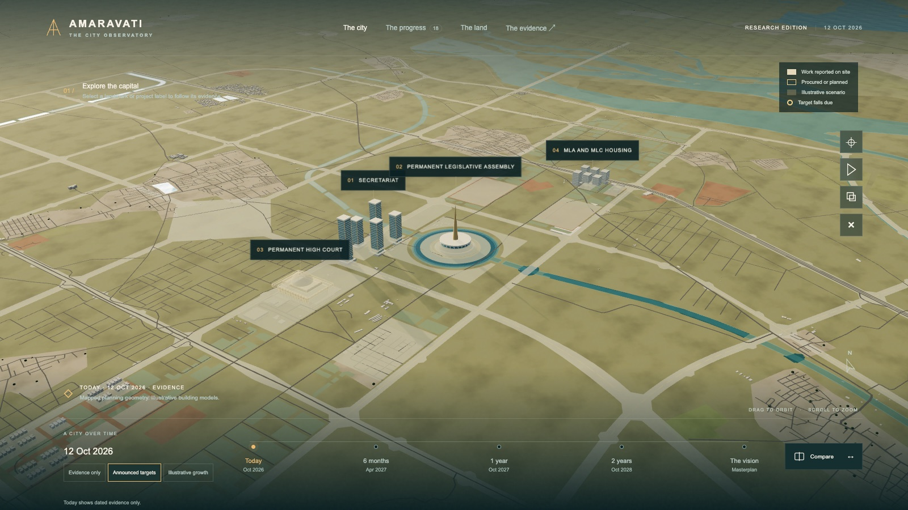

# Amaravati Observatory

An evidence-first 3D observatory of Amaravati, the Andhra Pradesh capital under construction. It shows a planning-and-massing study of the city on real APCRDA and OpenStreetMap geometry, beside a ledger of major projects where every claim keeps its source and its date.



**What it shows**

- **3D study.** Physical sky, image-based lighting and the Krishna river, plus the following layers:
  - existing buildings, land use, roads and rail from OSM
  - true-width planned trunk roads, the planned blue network and flood bunds from APCRDA
  - government parcels, land allotments and land programmes from APCRDA

  Landmark models are illustrative. Their style follows the evidence: **solid** for work reported on site, **outlined** for procured or planned work, **translucent** for illustrative scenarios.
- **Timeline** from `data/scenarios.json`, with three modes. *Evidence only* shows nothing beyond published evidence. *Announced targets* marks projects whose announced target falls due by the chosen date; a target is not delivery. *Illustrative growth* adds speculative massing. **Compare** shows today's evidence and the chosen scenario through one camera.
- **Project ledger** of 18 project groups. Each has status, evidence date, stale-evidence flags, announced targets and target history, contractors and contract values, dated milestones and sources with confidence levels. You can filter, sort and search by name, contractor, status or source title.
- **The land and the money.** APCRDA land allotments (Feb 2025) by allottee group, the largest allotments, and land mapped for monetisation, HUDCO security, R5-zone housing and industry. Also the reported funding lines and a sourced capital history from 2014 to now.
- **Deep links.** Every view is shareable, for example `/#project=quantum&t=2&mode=announced_targets`.

## Run locally

Needs Node 18+ (or Python 3 as a fallback).

```sh
npm start              # or ./start-local.sh, or start-local.ps1 on Windows
```

Open http://127.0.0.1:4267/. The site is static and loads everything locally. There's no API key and no CDN. Add `?quality=low|medium|high` to override adaptive rendering quality.

## Deploy (Vercel)

`vercel.json` serves `site/` as a static site with no build step. It sets a strict Content Security Policy (no inline scripts) and cache headers. Import the repository in Vercel, or run `vercel --prod` from the repo root. Social previews use `site/og.jpg`.

Before a public launch, resolve redistribution permission for the APCRDA geometry (see [Boundaries](#boundaries)).

## Data pipeline

| Step | Command | Output |
|---|---|---|
| APCRDA planning layers | `npm run data:apcrda` | `site/data/{boundary,roads,roadsurfaces,water,bunds,government,parcels,allotments,allotments2019,landprogrammes,zones,startup}.json`, `data/layer-manifest.json` |
| OpenStreetMap context | `npm run data:osm` | `site/data/{river,landuse,osmroads}.json`, `site/data/buildings.bin`, `data/osm-manifest.json` |
| Build and validate | `npm run build` | copies curated data into `site/data/`, writes `stats.json` |
| CI check | `npm run check` | validates everything; fails if `site/data` is stale |

How the collectors work:

- **APCRDA layers.** The fetcher requests native UTM 44N coordinates and reprojects them locally (checked against server output to within 0.1 mm). Many layers fail when the server is asked to reproject; requesting native coordinates is how all 35 road layers are recovered. It pages through object IDs and checks every layer against the server's own feature count.
- **Privacy.** Only allowlisted attributes are published. Some raw layers carry personal fields such as Aadhaar numbers and farmer names. Those stay in git-ignored `data/raw/<stamp>/`, and `build_site.py` fails if a blocked field ever reaches `site/data`. Names of individual (non-institutional) land allottees are withheld.
- **OSM data** comes through Overpass with mirror fallback. Buildings are clipped to the capital boundary and packed into a compact binary file (format documented in `scripts/fetch_osm.py`). Heights come from OSM `height` or `building:levels` where tagged. Untagged buildings are drawn at an assumed single storey.

**Building coverage in this commit is partial.** It has 26,137 buildings. One riverside block inside the capital (about 16.575–16.59° N, 80.475–80.50° E) never downloaded because Overpass kept timing out. The fetch is resumable: run `python scripts/fetch_osm.py --only=buildings` to download only the missing tiles, or add `--from-cache` to repack what's cached. Then run `npm run build`.

**Curated files are hand-edited and never regenerated:** `data/projects.json`, `sources.json`, `scenarios.json`, `history.json` and `funding.json`. The collectors don't research project claims.

`research/additions-2026-10.json` holds the October 2026 research pass (contracts, values, target histories, milestones, funding and history) that was merged into the registry. Each fact has its source and a confidence level.

### Project record fields

`status` sets the evidence tier. `evidence_date` is the latest dated evidence and `checked_on` is the review date. `announced_target` is the latest reported target; it may be text, such as "2.5 years from award", which is never placed on the timeline. Other fields: `target_history[]`, `milestones[]`, `contractor`, `value`, `value_alternates[]`, and `map`, which links a project to geometry. For example, `{"dataset": "allotments", "where": {"category": "Hotels"}, "basis": "…"}`. Projects without verified geometry have no `map` and get no map pin.

## Automation

- `.github/workflows/check.yml` runs on every push and pull request. It validates data and the privacy allowlists, syntax-checks the modules and smoke-tests the server.
- `.github/workflows/refresh.yml` runs every Monday and on demand. It re-fetches APCRDA and OSM data, rebuilds and opens a **pull request** for review. It never edits curated claims and never merges itself. It needs *Settings → Actions → General → Allow GitHub Actions to create and approve pull requests*.

## Project layout

```
site/            static site (Vercel output directory)
  js/            modules: main, state (URL), ledger, panel, timeline, insights, format
  js/scene/      3D: environment, context, buildings, landmarks, overlays, quality, build helpers
  data/          generated + copied datasets the site reads
  vendor/        pinned Three.js 0.184.0 (npm run vendor)
data/            curated registry and manifests; data/raw/ is git-ignored
scripts/         collectors, build/validate, vendoring, JS checks
research/        data, design and validation briefs; research passes
```

## Boundaries

- APCRDA planning geometry isn't proof of construction. Allotment isn't construction, and approval isn't disbursement.
- FAR isn't a floor count. Most OSM buildings have no height tag.
- Landmark buildings are original illustrative massing, not official architectural models.
- Future views are labelled scenarios, not forecasts.
- Public access to APCRDA layers doesn't establish redistribution permission. Preserve attribution and resolve permission before a public release.
- OSM data is © OpenStreetMap contributors (ODbL). See [LICENSE](LICENSE) for code and data terms.
